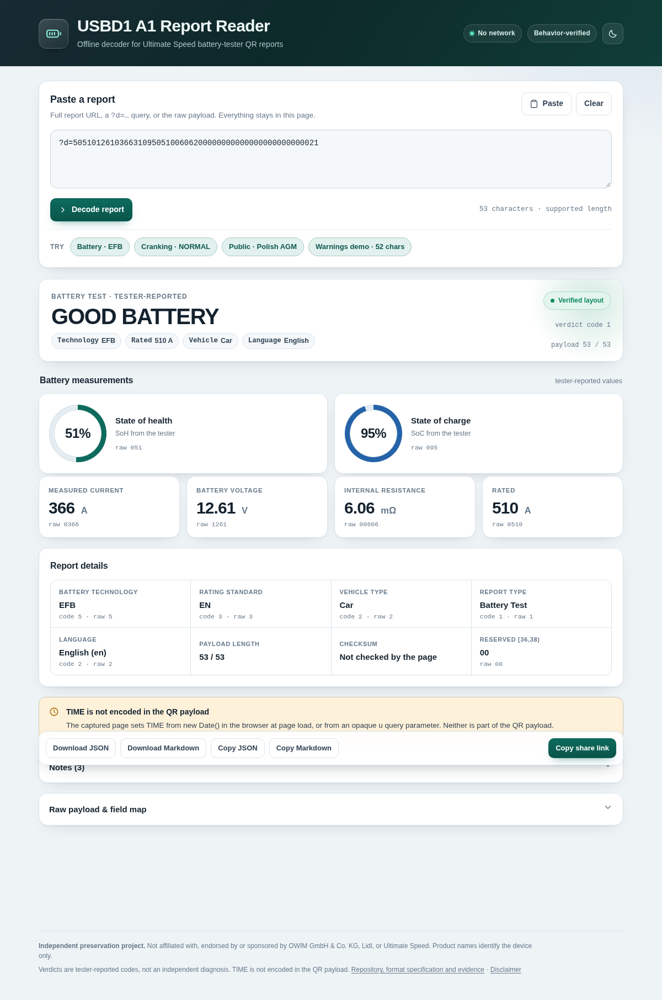

# USBD1 A1 QR report decoder

An offline decoder and format specification for the QR reports printed by the
**Ultimate Speed USBD1 A1** car battery tester.

The tester's QR code contains a URL like:

```
https://e.dh5z.com/?d=50510126103663109505100606200000000000000000000000021
```

That page is a client-side single-page app. All measurement data is in the `d` query
parameter. This project reads that parameter **without the vendor domain**,
using an independently written decoder.

**Live demo:** <https://catalingb.github.io/usbd1-a1-qr-decoder/>

<picture>
  <source media="(prefers-color-scheme: dark)" srcset="docs/screenshot-dark.png">
  
</picture>

> **Independence:** this is not an OWIM, Lidl or Ultimate Speed project. The
> vendor's code is not included. See [NOTICE](NOTICE),
> [DISCLAIMER.md](DISCLAIMER.md) and
> [evidence/legal-and-pii.md](evidence/legal-and-pii.md).

## What works

* Full report URLs, `?d=…` strings, `d=…` strings and raw payloads.
* All four report types: battery, cranking, charging and “all”.
* All captured battery technologies, verdicts, standards, vehicle types and
  the 71-entry JIS designation table.
* All 19 captured language codes (the report's own language, including
  localized verdict/type labels).
* Raw payload and every raw slice are preserved. Zero, missing, invalid and
  unknown are reported separately.
* JSON and Markdown export.
* Unsupported lengths and unknown codes are flagged; the decoder does not
  silently pretend they are valid.

`ok: true` means "no fatal format error" (for example, length 53 and all slices
present). It does **not** mean every code is known. Unknown codes, non-decimal
numeric fields and other oddities are warnings in `issues`; use `--strict` in
the CLI if you want warnings to fail.

**Completeness claim:** complete for the captured application version
(captured 2026-11-06, still served and stable in a public archive snapshot) and the branches listed in
[FORMAT.md](FORMAT.md). It is **not** claimed complete for other firmware
versions, unknown codes, the optional opaque `u` parameter, the tester's
diagnostic algorithm, or the unknown reserved slice `[36,38)`.

## Quick start

### 1. The hosted page (GitHub Pages)

Open <https://catalingb.github.io/usbd1-a1-qr-decoder/>. It is the same
single-file decoder, served over HTTPS. You can paste a full report URL or the
raw payload, or open the page with `?d=…` appended and it decodes
automatically:

```
https://catalingb.github.io/usbd1-a1-qr-decoder/?d=50510126103663109505100606200000000000000000000000021
```

The hosted page has no analytics, no CDN and no vendor-domain requests. It is
convenient, but the local file below is the durable copy: GitHub Pages can go
away too.

### 2. The standalone HTML app

Open [`decoder.html`](decoder.html) in a browser. It is a single file with no
CDN, no build step, no analytics and no network requests. Drag it to a USB
stick if you like. `index.html` is the identical GitHub Pages entry point;
`decoder.html` is the same build under its descriptive name.

Paste a report URL (or the raw `d` value), press **Decode**. Use the sample
buttons to see the verified reports.

The page can also be opened directly with a report URL appended:

```
file:///path/to/decoder.html?d=50510126103663109505100606200000000000000000000000021
```

### 3. Command line

```bash
node cli/decode.mjs 'https://e.dh5z.com/?d=50510126103663109505100606200000000000000000000000021'
node cli/decode.mjs --json '50510126103663109505100606200000000000000000000000021'
node cli/decode.mjs --markdown < payload.txt
```

No dependencies. Node.js 18 or newer.

Exit codes: `0` decoded, `1` usage, `2` no `d` payload, `3` unsupported
payload length, `4` `--strict` found warnings/unknown codes.

### 4. Library

```js
const { decode } = require('./src/decoder.js');
const r = decode('https://e.dh5z.com/?d=...');
console.log(r.battery.verdict.label); // "GOOD BATTERY"
console.log(r.input.payload);         // raw string, leading zeros intact
console.log(r.issues);               // structured warnings
```

### 5. Build and tests

```bash
npm run build     # regenerate decoder.html from src/
npm test          # 173 tests, no dependencies
```

The tests include **2,337 differential field comparisons** against the parsed
state of the captured renderer (125 curated cases × 19 fields, 0
mismatches).

Optional browser acceptance test (needs `playwright-core` and Chromium):

```bash
npm i -D playwright-core
node tools/offline-browser-test.cjs
```

## Verified samples

| Report | Payload | Result |
|---|---|---|
| Battery | `5051…0021` | EFB, GOOD BATTERY, SoH 51%, SoC 95%, 366 A, 12.61 V, EN, 510 A, 6.06 mΩ, Car |
| Cranking | `0000…0022` | NORMAL, 10.6 V, 3580 ms |
| Public indexed | `2076…0c1` | AGM Flat Plate, GOOD-RECHARGE, SoH 66%, SoC 83%, 618 A, 12.53 V, EN, 760 A, 3.59 mΩ, Car, Polish |

Full payloads and the exact captured rendered text are in
[`fixtures/samples.json`](fixtures/samples.json).

### Verification status by report type

| Report type | Code | Evidence |
|---|---|---|
| Battery Test | `1` | Real device QR + live renderer + differential tests |
| Cranking Test | `2` | Real device QR + live renderer + differential tests |
| Charging Test | `3` | Verified against the captured renderer + differential tests; **no real device QR captured yet** |
| All tests | `4` | Verified against the captured renderer + differential tests; **no real device QR captured yet** |

The decoder handles all four because the report type is simply the last payload
character (`[52,53)`), and the captured renderer’s type 3/4 branches were
exercised with controlled 53-character payloads. What is missing is a
device-generated Charging or ALL QR to use as a real-world fixture. If you can
scan one, add it to `fixtures/samples.json`; that closes the last evidence gap.

Unknown/future report-type codes are not silently decoded: the page shows no
test section and the decoder reports `unknown_report_type`. The optional
opaque `u` parameter is not a QR report type; it is a website display-date
parameter and is ignored.

## The important finding: TIME is not in the QR

The payload contains **no date or time**. The vendor page fills its `TIME`
field with `new Date()` when the page loads (or with a date chosen in the date
picker, stored in an opaque `u` parameter). It changes on every reload and
depends on the browser's timezone.

So a report showing `2026-11-06 17:53:59` does **not** prove the battery was
measured at that time. Do not use the vendor page's TIME as a measurement
timestamp. This decoder reports `encoded_in_payload: false` and never invents
one.

## Reading a future QR code

1. Scan the QR with any ordinary QR scanner (the phone camera is fine).
2. Copy the whole URL or just the `d` value.
3. Paste it into `decoder.html` and press **Decode**.
4. Save the JSON/Markdown if you want a permanent record.
5. Keep the original QR text too: it is the primary evidence.

You can also decode from the terminal with `cli/decode.mjs`.

If a future report has a different length or unknown codes, the decoder will
say so. Do not override the warning; capture the new payload and add it as
evidence (below).

## What the QR does and does not contain

**Contains:** battery type, rated value, measured voltage/current, standard,
battery verdict, SoC, SoH, internal resistance, vehicle type, cranking
voltage/duration/verdict, charging loaded/unloaded/ripple/verdict, language and
report type.

**Does not contain:** date/time, VIN, plate number, vehicle model, battery
serial, tester serial, GPS, customer name. The optional `u` parameter is not
part of the QR; the decoder ignores it and redacts it from exports.

## Backing it up

Keep at least:

* `decoder.html` (the whole decoder in one file),
* this repository (or a zip of it),
* `FORMAT.md` (readable without a computer),
* your original QR text/URLs.

Suggested: one copy on the PC, one on a USB stick or external drive, one in a
private repository or private cloud folder. The decoder has no runtime
dependencies, so it will keep working as long as a browser can open a local
HTML file.

## Adding evidence for another firmware or tester

1. Capture the new QR text and the complete rendered report (screenshot and
   text).
2. If the site is still up, save the page HTML and any publicly served assets
   with a date-stamped filename.
3. Add a `fixtures/samples.json` entry with the payload and expected values.
4. If the length or layout changed, do **not** edit the existing field table to
   fit. Add a new format id and a separate spec section; keep the old one.
5. Add a test that fails on the new payload until the new layout is
   understood.
6. Record the evidence in `evidence/`, including the capture date and any
   hashes you keep privately.

## Repository layout

```
decoder.html            single-file offline app (generated)
index.html              identical GitHub Pages entry point (generated)
DISCLAIMER.md           independence, no-warranty and rights-holder notice
src/decoder.js          parser + decoder library (UMD)
src/locales.js          captured label tables (short functional labels)
src/ui.js               browser UI
cli/decode.mjs          command-line interface
FORMAT.md               readable format specification
format.schema.json      JSON Schema for decoder output
format.spec.json        machine-readable payload/field/enum specification
INVESTIGATION.md        how it was verified; evidence grades
fixtures/               verified samples + captured reference parser state
tests/                  node:test suite (no dependencies)
evidence/               headers, method notes, observations, validation output
evidence/private/       private capture records (gitignored, not published)
tools/                  HTML build and optional browser test
licenses/               third-party notices (none required at runtime)
```

## Known limitations

* Only the captured web-application version and 53-character payloads are
  verified.
* Unknown codes are shown as unknown, not guessed.
* `[36,38)` is reserved/unused by the page; its meaning is unknown.
* The `u` parameter is not decoded. It is not part of the QR.
* The tester's measurement/diagnostic algorithm is not reconstructed; verdicts
  are encoded tester-reported codes.
* Whether the tester computes a checksum is unknown. The web page does not
  validate one.
* Localized labels are reproduced as captured, including vendor translation
  quirks.
* QR image/camera scanning is not built in; paste the text from any scanner.
  This keeps the app dependency-free and avoids camera permission issues on
  `file://`.

## Legal and PII

* Public site, no access control bypass, no anti-abuse bypass.
* Vendor code, capture records and any embedded secrets are **not**
  redistributed. Detailed records are kept only in the gitignored
  `evidence/private/`.
* The `d` payload contains no personal data. The three examples contain no
  plate, VIN, serial or customer data.
* The decoder makes no network requests, has no telemetry and stores nothing.
* “Ultimate Speed”, “USBD1 A1”, “Lidl” and “OWIM” are used only to identify the
  device. No affiliation or endorsement is claimed.
* This is not legal advice; reverse-engineering rules differ by jurisdiction.

See [NOTICE](NOTICE), [evidence/legal-and-pii.md](evidence/legal-and-pii.md)
and [INVESTIGATION.md](INVESTIGATION.md).

## License

Original code and documentation: MIT. See [LICENSE](LICENSE). Vendor
trademarks and captured label strings remain their owners' material; see
[NOTICE](NOTICE).
